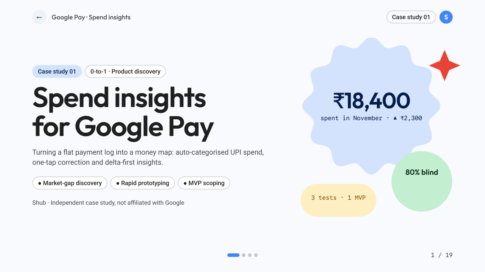
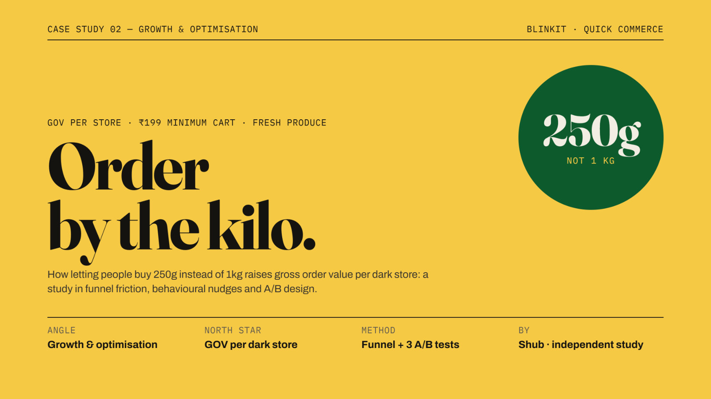
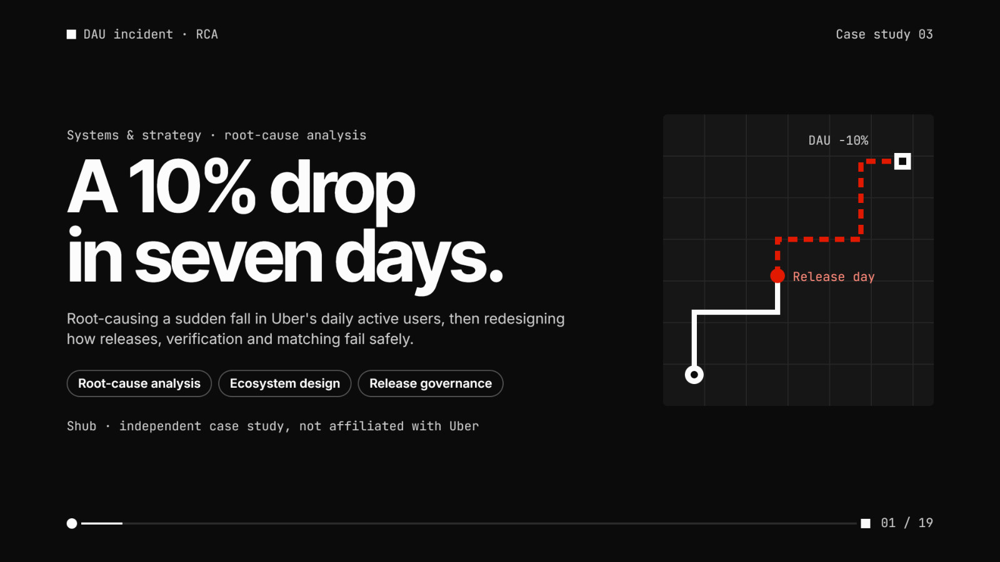

# Product Case Studies

Three independent product case studies by [Shubham Kanauji](https://github.com/BuildwShub), Product Manager. Each one starts with a problem, makes a call, and says what to leave out.

> These are independent exercises. They are not affiliated with or endorsed by Google, Blinkit or Uber. Figures marked *(est.)* are modelled assumptions, and *(simulated)* marks invented scenario data.

## 1. Google Pay: Spend Intelligence

**Question:** how can a flat payment log become a clear view of spending?

- 80% of 36 surveyed users had no automated view of their spending.
- Three cheap tests, designed to challenge the idea early, each changed the scope.
- Eight ideas scored with RICE, and three cut on purpose.

**Skills:** user research, rapid prototyping, RICE, MoSCoW

**[Read the case study (PDF)](Google-Pay-Spend-Intelligence.pdf)**

## 2. Blinkit: Order by the Kilo

**Question:** can selling 250g instead of 1kg raise order value per dark store?

- Research with 55 users showed small, frequent, value-seeking baskets.
- Order by the kilo scored 102.4 on RICE against 64.0 for subscriptions.
- Three A/B tests, each with a guardrail. Target: +9% GOV per store *(est.)*.

**Skills:** funnel analysis, A/B testing, RICE, behavioural design

**[Read the case study (PDF)](Blinkit-Order-by-the-Kilo.pdf)**

## 3. Uber: DAU Drop

**Question:** why did daily active users fall 10% after one release *(simulated)*?

- Three changes failed together and fed one cancellation loop.
- One decision per change, instead of a blanket rollback.
- A release pipeline with flags, a 1% canary, health gates and automatic rollback.

**Skills:** root-cause analysis, release governance, stakeholder trade-offs

**[Read the case study (PDF)](Uber-DAU-Drop.pdf)**

---

[Portfolio](https://shubham-kanauji-pm.vercel.app) · [LinkedIn](https://linkedin.com/in/foxsalsa)
